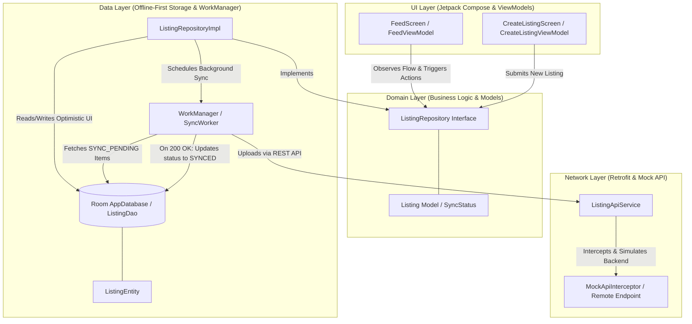

# Offline-First Marketplace App

An offline-first Android Marketplace application built with modern Android development standards, Jetpack Compose, Room Database, WorkManager, Hilt, and Retrofit with an embedded Mock REST API.

---

## Architecture Overview

The app follows the **Clean Architecture + Unidirectional Data Flow (UDF)** guidelines recommended by Android:



---

## CPU and Memory Cosiderations
For 60 fps performance of various devices each fram has to compute in 16ms. FOr smooth scrolling using LazyColumn is used, which load items lazily as displayed. For Image loading Coil 
library does bitmap downscaling and caching of images in memory to get smooth scroll and no image is loaded from disk/network again.
For CPU, Coroutines are widely used to keep UI thread free without janks, all room transaction are done in coroutines, Sync worker is coroutine worker as well.

---

##  Tech Stack & Tools
- **Language**: Kotlin
- **UI Framework**: Jetpack Compose & Material 3
- **Dependency Injection**: Hilt (`@HiltAndroidApp`, `@HiltViewModel`, `@HiltWorker`)
- **Database**: Room Database (`androidx.room3`)
- **Networking**: Retrofit + OkHttp `MockApiInterceptor` (Zero external setup required)
- **Background Jobs**: WorkManager (`SyncWorker` with `NetworkType.CONNECTED` constraint)
- **Image Loading**: Coil 3
- **Testing**: JUnit4, MockK, Kotlinx Coroutines Test

---

##  Running the Project
1. Open the project in **Android Studio**.
2. Sync Gradle files.
3. Select the `app` run configuration and click **Run** (Ctrl+R / Shift+F10).
4. Run unit tests using:
   ```bash
   ./gradlew testDebugUnitTest
   ```
